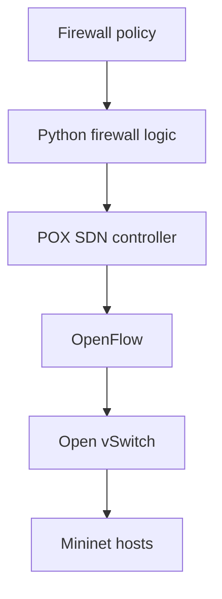
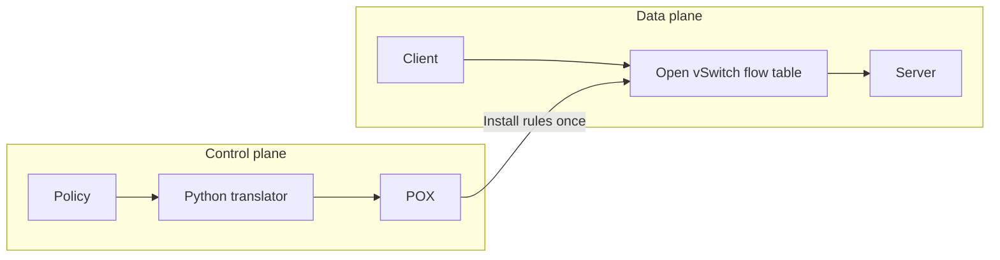

# Programmable SDN Firewall

A Python-based Software-Defined Networking firewall demonstrating programmable traffic filtering, OpenFlow rule management, and network security.

**Status:** documentation only. This repository explains the design. It does not ship controller code, a policy file, a topology, container definitions, or a packet capture.

This is a technical overview of work I did while studying centralized network control. It is written for recruiters and engineers who want the architecture, the engineering problems, and the skills involved. Protected course files are not publicly distributed.

## Contents

- [Project overview](#project-overview)
- [Problem statement](#problem-statement)
- [Key features](#key-features)
- [Technology stack](#technology-stack)
- [System architecture](#system-architecture)
- [How the firewall works](#how-the-firewall-works)
- [Project structure](#project-structure)
- [Getting started](#getting-started)
- [Firewall policy example](#firewall-policy-example)
- [Testing and validation](#testing-and-validation)
- [Engineering challenges](#engineering-challenges)
- [Skills demonstrated](#skills-demonstrated)
- [Lessons learned](#lessons-learned)
- [Limitations](#limitations)
- [Future improvements](#future-improvements)
- [Project background](#project-background)
- [Contributing](#contributing)
- [License](#license)
- [Author](#author)

## Project overview

Traditional firewalls are configured on each device. A software-defined network separates that decision from the hardware that forwards packets. A controller program decides which traffic may pass. The switches enforce the decision.

This project is a programmable firewall built on that model. A text policy describes which packets to allow or block. Python turns each policy entry into an OpenFlow rule. The POX controller installs those rules on an Open vSwitch instance. Mininet supplies the hosts and links used to test the result.

The work sits at the intersection of backend software, network security, and reproducible lab infrastructure. The filtering behavior comes from configuration and a small translator, not from hand-written rules for each switch.

## Problem statement

Managing security policy device by device does not scale cleanly.

- Each firewall or router has its own command syntax.
- The same intent has to be copied onto every device that can see the traffic.
- A missed device, or a rule entered in the wrong order, silently changes who can connect.
- Reviewing the live network means logging into boxes instead of reading one policy.

Software-defined networking treats forwarding as a software problem. One control program holds the policy. Switches on the data path install the resulting rules and apply them locally. This project explores that approach in a simulated network. It was not deployed in production.

## Key features

These capabilities were implemented and exercised in the private coursework environment.

| Feature | What it is for |
|---|---|
| Configuration-driven policy | Security intent stays in a policy file. The program does not hardcode which hosts may talk. |
| Source and destination IP matching | Rules can name one host or a whole subnet. |
| CIDR subnet matching | A prefix length selects a range, such as a `/24` or a single host as `/32`. |
| MAC address matching | A rule can key off a hardware address when the IP is not the right identifier. |
| Protocol matching | A rule can select ICMP, TCP, UDP, or another IPv4 protocol number. |
| TCP and UDP port matching | A rule can name an application port in either direction. |
| Allow and Block actions | Block drops the matching packets. Allow forwards them. |
| Priority between overlapping rules | When two rules match the same packet, Allow is installed above Block, so an exception can override a broader deny. |
| Default allow | Traffic that matches no firewall rule continues through ordinary switch forwarding. |
| OpenFlow flow installation | Rules are installed when the switch connects, so later packets are handled on the switch. |
| Containerized lab | Mininet, Open vSwitch, and POX run in one Docker environment so the lab can be reproduced on a workstation. |
| Simulated connectivity tests | ICMP, TCP, and UDP checks compare expected and actual reachability. |

## Technology stack

| Technology | Purpose |
|---|---|
| Python 3 | Policy translation and controller logic. |
| POX | Open-source SDN controller that hosts the firewall module and speaks OpenFlow. |
| OpenFlow 1.0 | Protocol used to install match, priority, and action rules on the switch. |
| Open vSwitch | Virtual switch that stores the flow table and forwards or drops packets. |
| Mininet | Network emulator that creates hosts, links, and the switch for tests. |
| Docker and Docker Compose | Packages the lab tools into one privileged container. |
| Linux | Network namespaces, interfaces, and process control inside that environment. |
| Wireshark / tshark | Inspection of Ethernet, IPv4, ICMP, TCP, and UDP headers during capture work. |

## System architecture



1. **Policy definition.** A person writes the intended allows and blocks: addresses, protocol, ports, and an action. Fields that should match any value are left unspecified.
2. **Policy parsing.** Startup code reads the file into one record per rule. Every value arrives as text and is checked for shape before use.
3. **OpenFlow rule generation.** The firewall function builds one flow modification per record. It fills only the fields the record actually sets, adds the IPv4 Ethernet type when an IP field is present, and chooses a priority from the action.
4. **Controller communication.** POX listens for the switch. When the switch connects, the controller sends the prepared flow modifications.
5. **Flow table installation.** Open vSwitch stores each rule as a row: match, priority, and action.
6. **Packet matching.** For each packet, the switch selects the matching row with the highest priority.
7. **Forward or drop.** A block row has no output action, so the packet is discarded. An allow row outputs through the switch's normal forwarding path. A packet that matches nothing is handled by the controller's ordinary learning switch.

The control plane is POX plus the Python policy logic. The data plane is Open vSwitch and the links between Mininet hosts. After installation, the switch applies matching rules itself.

## How the firewall works

Consider a generic case. A client opens a connection to a server. The policy says that this client may reach that server on the given protocol and port, while a broader rule would otherwise block the same service.

The translator builds two OpenFlow rules. The broader rule matches the service and has no output, so it drops traffic. The exception matches the permitted client and server and carries a forward action. Its priority is higher, so the switch uses the exception when both rules match.



That split is the practical point of OpenFlow. The controller is consulted when the switch connects, and when a packet matches no installed rule. It is not consulted again for every packet that already matches a firewall row. The data plane stays fast, and the policy stays in software.

A few matching details matter in practice:

- An IP or port match is ignored by OpenFlow unless the Ethernet type is IPv4.
- A port match is ignored unless the IP protocol is TCP or UDP. If a policy names a port and leaves the protocol open, the safe translation is one TCP rule and one UDP rule.
- A subnet is a network address plus a prefix length. Passing a CIDR string straight into an address constructor is not valid in this POX version. The prefix has to be parsed first.
- A dash, or any other explicit "any" marker, must be omitted from the match. Writing it in as a literal address would match the wrong packets.

## Project structure

This public repository is documentation only.

```text
README.md    architecture, design notes, and portfolio context
```

| Path | Purpose |
|---|---|
| `README.md` | This document. Architecture, testing approach, and portfolio context. |

There is no controller module, policy file, topology, container definition, test suite, or capture in this repository. Commands that build or run the original coursework environment are intentionally omitted.

## Getting started

Nothing in this repository can be installed or executed. The sections below describe how to reproduce the *ideas* in a project you write yourself.

### Prerequisites for an independent lab

These are tools for a new demonstration, not install steps for the course project:

- Linux, or Docker with support for privileged containers
- Python 3
- An OpenFlow controller you are allowed to use
- Mininet and Open vSwitch
- `ping`, plus a small TCP client and server
- `tcpdump` or `tshark` if you want to inspect headers

### Reproducing the concepts

1. Install Docker, or install Mininet, Open vSwitch, and a Python 3 OpenFlow controller on Linux.
2. Write your own topology with fictional hosts and addresses. Do not reuse a course topology.
3. Write your own policy format and translator. Decide how unspecified fields, CIDR prefixes, and allow-versus-block priority work.
4. Start the controller before the simulated network, then install rules when the switch connects.
5. Test with ordinary tools: `ping` for ICMP, and small TCP and UDP programs for ports.
6. Capture on a host interface with `tcpdump` or `tshark` if you want to inspect headers.
7. Shut the network down and clear leftover switches before the next run.

That is a new project. It is not a mirror of the coursework. There is no supported command in this repository for starting a controller or a topology.

## Firewall policy example

The following example is illustrative. It is not a file in this repository, and it is not the course policy.

| Field | Value | Meaning |
|---|---|---|
| Source | `203.0.113.10/32` | One client. `203.0.113.0/24` is a documentation prefix, not a lab network. |
| Destination | `203.0.113.50/32` | One server. |
| Protocol | TCP | Only connection-oriented traffic. |
| Port | Destination 443 | HTTPS on the server. |
| Action | Block | Drop packets that match all of the fields above. |

A second illustrative entry could allow `203.0.113.10/32` to reach `203.0.113.80/32` on TCP port 443. If both entries can match a packet, the allow entry must be installed at a higher OpenFlow priority than the block. Otherwise the broader block wins and the exception does nothing.

Unspecified fields mean "any." A rule that sets only a destination subnet and TCP port 443 applies to every source.

## Testing and validation

Testing was done in Mininet against the private implementation. I compared expected connectivity with what the hosts actually observed. An external autograder was not part of this write-up, so I do not claim an official score.

| Test category | Expected behavior | Verification method |
|---|---|---|
| ICMP | Echo requests succeed when no block matches, and fail when a block matches | `ping` between Mininet hosts |
| TCP | A permitted session completes an application exchange | Small TCP client and server on chosen ports |
| UDP | A permitted datagram is delivered and echoed | Small UDP client and server |
| Allowed traffic | Hosts outside a block, or covered by a higher-priority allow, connect | Paired cases: one flow that should pass, one that should not |
| Blocked traffic | The client does not complete the exchange | Timeout or total packet loss, with a server running so a closed port is not mistaken for a filter |
| Rule priority | A specific allow still wins when a broader block also matches | Overlapping policy entries and a flow-table dump |
| Subnet and port scope | A prefix blocks the intended range and leaves neighboring hosts or ports alone | Boundary hosts just inside and just outside the prefix |
| Packet capture | Ethernet, IPv4, ICMP, TCP, and UDP headers are visible | `tshark` on a host interface during a separate capture exercise |

Local sessions matched those expectations for the cases I ran. I do not report a coverage percentage or a performance number. None was measured.

## Engineering challenges

| Challenge | Technical cause | Approach | Result |
|---|---|---|---|
| Policy text is not an OpenFlow match | Empty fields, ports, and CIDR strings are text. OpenFlow ignores IP fields unless the Ethernet type is IPv4. | Translate only fields that are set, and set the IPv4 type whenever an IP field is present. | Installed rules kept the addresses and ports the policy named. |
| CIDR strings | This POX version's address constructor rejects a combined CIDR string. A subnet is an address plus a prefix length. | Parse the CIDR first and store that pair on the match. | Host routes (`/32`) and wider prefixes installed as written. |
| Port with no protocol | OpenFlow matches a transport port only when the IP protocol is TCP or UDP. | If the policy names a port and leaves the protocol open, emit one TCP rule and one UDP rule. A named protocol still produces one rule. | Port filters applied to both transports instead of being dropped on install. |
| Overlapping allow and block | The switch uses the highest priority, so a block with more match fields can outrank a shorter allow. | Put every allow in a priority band above every block. Use specificity only inside one band. Keep both bands above the learning switch. | A shorter allow still forwarded when a broader block also matched. |
| Default allow vs. learned flows | The learning switch installs forward entries at the OpenFlow default priority. A lower-priority drop never wins. | Install firewall drops above that default. Leave unmatched traffic to the learning switch. | Blocks stayed in effect, and traffic with no matching rule still passed. |
| Request versus reply | On the reply, the server's source port is the port the client used as its destination. | Match a service response on the server address and the source port. | Filters aimed at replies no longer blocked the client's request by mistake. |
| Ping pass/fail parsing | `100% packet loss` contains the text `0% packet loss`. | Match the loss statistic as its own field. | Blocked and allowed pings were classified correctly. |
| Lab startup | Mininet needs network namespaces. The switch fails if no controller is listening. Windows CRLF endings break shell scripts in Linux. | Run the lab container privileged, start the controller first, and normalize line endings. | The simulator reached a state where connectivity tests meant something. |

## Skills demonstrated

**Software engineering**

- Python 3, including careful handling of optional fields and typed conversions
- Configuration-driven behavior instead of hardcoded decisions
- Small, testable translation from records to controller messages
- Debugging with controller logs, flow-table dumps, and packet captures

**Networking**

- IPv4, ICMP, TCP, UDP, and Ethernet addressing
- CIDR subnetting and prefix boundaries
- OpenFlow matches, priorities, and actions
- Control-plane versus data-plane responsibilities
- Reading packet captures to confirm what was actually on the wire

**Security**

- Allow and block policy, including exceptions to a broader block
- Filtering on address, protocol, and port
- Isolating a host in both directions when the policy requires it
- Distinguishing a client request from a server response

**DevOps and systems**

- Docker Compose as the lab runtime
- Linux interfaces, namespaces, and process cleanup
- Repeating a test from a known clean switch state

## Lessons learned

Central control is only useful if the data plane can enforce it alone. Installing a precise flow once is a different design from sending every packet to a program. Priority is part of the policy, not a cosmetic field: two correct matches still produce the wrong outcome if the drop is installed above the exception.

Packet headers are directional. The same TCP session looks different on the request and on the reply, and a firewall that ignores that will open or close the wrong path. Simulation made those mistakes cheap to see. I could dump the flow table, capture one interface, and rerun a single host pair without touching hardware.

The software-engineering lesson I care about is the boundary between policy and mechanism. The translator should accept any valid record. The scenario-specific choices belong in configuration. That split is what makes the same program testable against a policy it has never seen.

## Limitations

- This repository cannot be cloned and run. The implementation stays private because of course rules.
- The firewall was exercised in a simulator. It was not deployed on production hardware.
- No external autograder result is included, and no performance or coverage number was measured.
- The implemented design is default-allow. A packet that matches no rule is forwarded. It does not fail closed.
- The work targeted IPv4 and OpenFlow 1.0. It is not a general next-generation firewall, and it does not inspect application payloads.

## Future improvements

None of the following was built. They are reasonable next steps for an independently written, publishable version of this kind of firewall.

- A small web UI or REST API to add and remove policy entries without editing a file by hand
- Schema validation that rejects a prefix whose host bits are not zero, before the controller starts
- Structured logs for each installed rule and each drop
- A regression suite that boots the simulator, applies a fixture policy, and exits nonzero on a mismatch
- Version control for policy changes, with a diff a reviewer can read
- A live view of the flow table and recent matches
- A second controller or a reconnect path so a restart does not leave the switch with a stale table

## Project background

I built the implementation while taking CS 6250 at Georgia Tech. The course materials, starter code, firewall configuration, and packet capture from that assignment are not in this repository and are not licensed for public redistribution.

## Contributing

Please do not open a pull request that adds course solution code, a course policy file, a course topology, or a course packet capture. Those files cannot be hosted here.

Notes that improve the accuracy or clarity of this document are welcome.

## License

No license is granted to Georgia Tech course materials. Those materials are not in this repository.

This README is a personal technical summary. It is not a license to recreate or redistribute the coursework.

## Author

**Azim Khamis**

I am interested in software engineering, backend development, cloud infrastructure, DevOps, Linux systems, and network security.

- GitHub: https://github.com/azim-khamis07
- LinkedIn: _add your profile URL_
